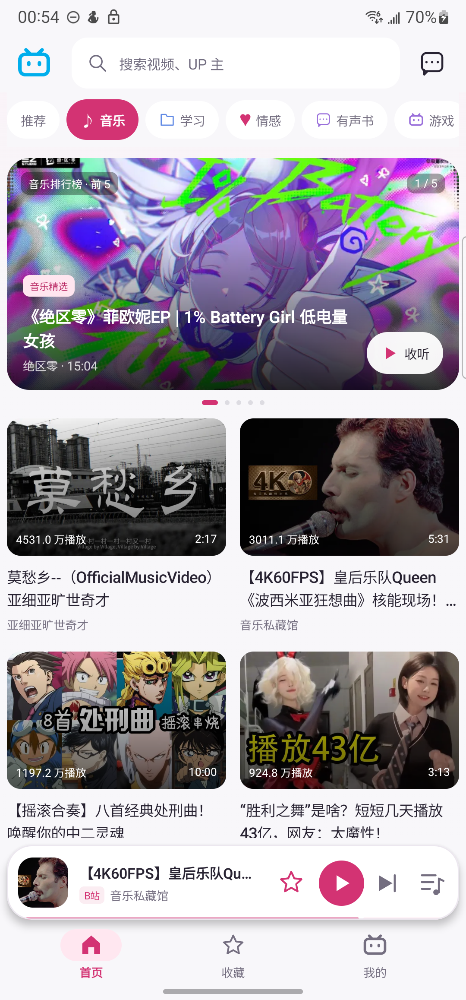
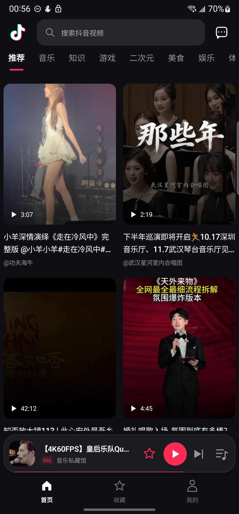
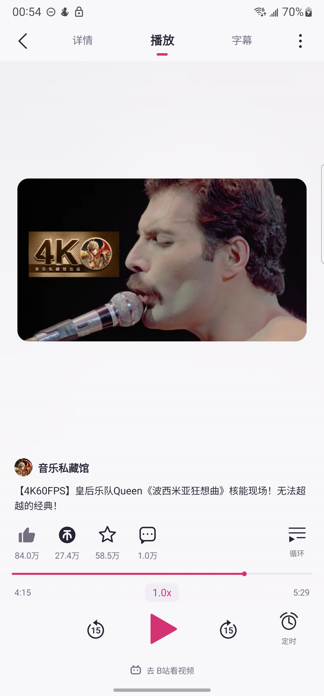
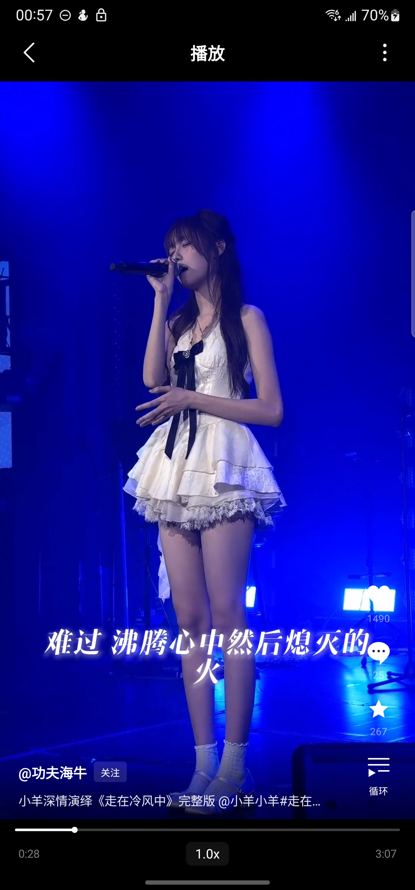
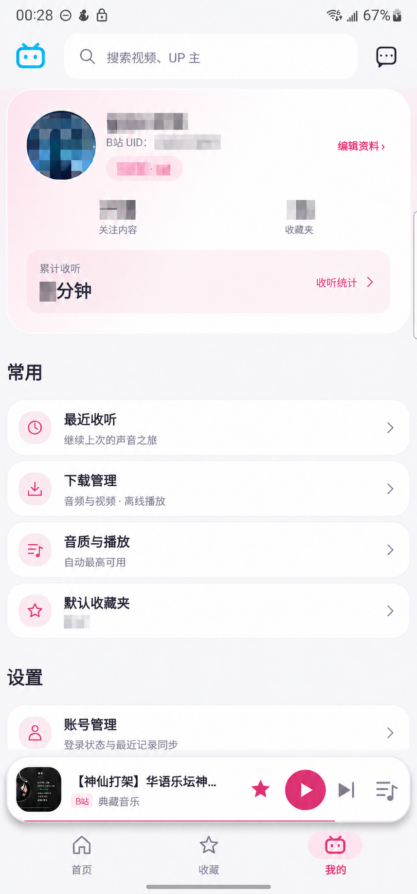
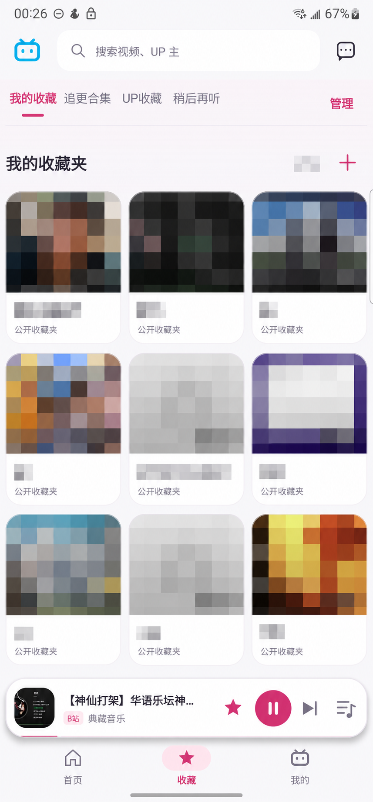
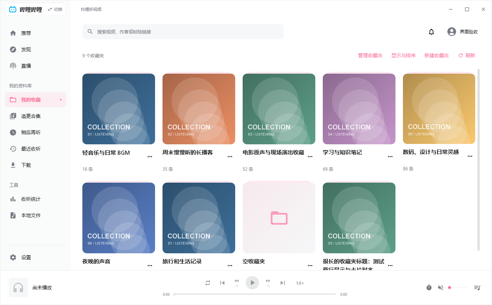
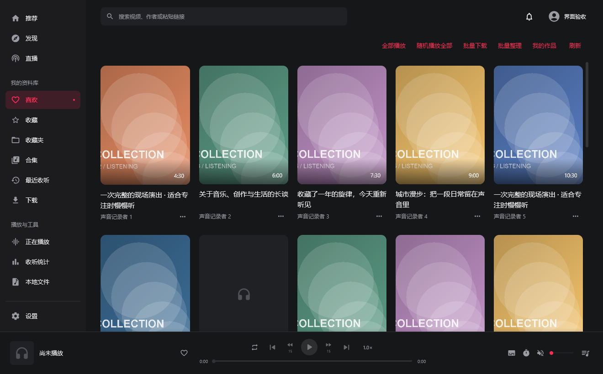

<h1>抖哩看视频</h1>

<strong>把喜欢的视频，听起来。想看时，也能看。</strong>

金色王冠（Golden Crown） · QQ 交流群：<strong>1126192808</strong>

  
  
  
  

  <a href="https://github.com/JinCrown/doulivideo/releases/latest">下载手机版与电脑版</a> ·
  <a href="https://github.com/JinCrown/doulivideo/issues">反馈问题</a> ·
  <a href="docs/PRIVACY.md">隐私与本地数据</a>

---

## 喜欢在 B站、抖音听歌和听视频的小伙伴们，你们好！

想听的那首歌，换了几个平台还是没找到？ 
喜欢的翻唱、现场、改编版本，最后又是在视频平台找到的？

所以，我正在做一款免费、无广告的播放器，让你把喜欢的视频听起来。

不只是把视频拿来听，更要让你**直接用上原来的收藏和合集**。

**在 B站、抖音看到喜欢的，收藏起来，回来接着听。** 
**在这里听到喜欢的，也能收藏到对应平台。** 
**两边各用自己的账号和收藏，不必重新搬一份歌单。**

搜索！收藏！想听的，一键播放！ 
锁屏、切后台，喜欢的声音继续听。 
想看画面？在播放器右上角「更多」里打开「看视频」，下次也会记住。

> 本仓库用于分享软件介绍、截图、安装包和使用说明，**不公开应用源码**。
> 安装后的应用显示名称为「抖哩听视频」。

## 下载与交流

| 设备 | 最新版本 | 安装包 |
| --- | --- | --- |
| Android 8.0 及以上 | **0.36.5-beta.1** | [下载安卓手机版](https://github.com/JinCrown/doulivideo/releases/download/v0.36.5-beta.1/doulivideo-0.36.5-beta.1.apk) |
| Windows 10/11 x64 | **0.14.22-beta.1** | [下载 Windows 版](https://github.com/JinCrown/doulivideo/releases/download/v0.36.5-beta.1/DouliListen-0.14.22-beta.1-windows-x64-setup.exe) |
| macOS · Apple Silicon（M 系列） | **0.14.22-beta.1 测试版** | [下载 M 系列 Mac 版](https://github.com/JinCrown/doulivideo/releases/download/v0.36.5-beta.1/DouliListen-0.14.22-beta.1-macos-arm64.dmg) |
| macOS · Intel | **0.14.22-beta.1 测试版** | [下载 Intel Mac 版](https://github.com/JinCrown/doulivideo/releases/download/v0.36.5-beta.1/DouliListen-0.14.22-beta.1-macos-x64.dmg) |

2026-10-25 更新：手机和电脑、B站和抖音均新增可搜索及排序的关注作者列表；同时补齐关注内容页、播放器评论与字幕开关，并修复电脑版加载及播放状态冲突。
[查看更新内容](RELEASE_NOTES.md) · [完整发布页](https://github.com/JinCrown/doulivideo/releases/tag/v0.36.5-beta.1) · [校验与组件材料](docs/releases/v0.36.5-beta.1/README.md)。

普通用户按设备下载 **APK**、**Windows setup.exe** 或对应芯片的 **Mac DMG** 即可，不需要下载 GitHub 自动生成的 Source code 压缩包。
Android 沿用原有发布签名；Windows 使用固定自签名内测身份，仍可能显示系统信任提示。具体升级、签名及校验说明见版本材料页。

Mac 测试包包含 Java、播放和登录运行库，无需另外安装 Java、VLC 或 FFmpeg。打开 DMG 后将应用拖到 Applications。本包使用临时本地签名，未取得 Apple Developer ID 签名及公证；首次被系统阻止时，可在「系统设置 → 隐私与安全性」按提示选择「仍要打开」，步骤见 [苹果官方说明](https://support.apple.com/zh-cn/102445)。已在 macOS 15 云构建机验证，真实账号和不同 Mac 设备仍需测试。

**QQ 交流群：1126192808**。也可以提交 [Issue](https://github.com/JinCrown/doulivideo/issues)，附设备型号、系统版本、软件版本与复现步骤。

## 手机界面

以下为手机实机截图，个人信息已打马赛克。

<table>
  <tr><th align="center">B站首页</th><th align="center">抖音首页</th><th align="center">听视频播放器</th></tr>
  <tr>
    <td align="center"></td>
    <td align="center"></td>
    <td align="center"></td>
  </tr>
  <tr><th align="center">看视频播放器</th><th align="center">我的</th><th align="center">收藏</th></tr>
  <tr>
    <td align="center"></td>
    <td align="center"></td>
    <td align="center"></td>
  </tr>
</table>

## 电脑版界面

以下是 0.14.14 的实际界面渲染预览，使用隔离样例数据；封面由测试代码绘制，不是用户的真实收藏。

**B站 · 我的收藏**

**抖音 · 喜欢**

## 听起来，有这些方便

### 以听为主，也能看

- **后台与锁屏播放**：切到其他应用、熄屏，继续听；支持通知栏和蓝牙耳机控制。
- **看视频开关**：默认关闭，在播放器「更多」里开启后记住选择；点击视频播放或暂停。
- **完整画面与横屏**：保留原始视频比例；横向视频可点击「全屏观看」，返回恢复竖屏。
- **互动布局自己选**：横排或竖排，用「更多」里的开关切换。
- **倍速与定时**：按自己的节奏听课程、播客，也能设置停止时间。
- **列表循环**：新队列默认列表循环，也能选择顺序、单条循环或随机播放。

### 两个平台，一处收听

- **B站与抖音**：点击首页左上角的平台图标切换，记住最后使用的平台。
- **搜索与推荐**：搜索想听的视频和作者，按分类发现内容，刷到下一条继续听。
- **提前准备下一条**：按网络设置预加载封面和播放开头，减少切换时的等待；实际速度取决于网络和平台响应。
- **收藏与合集**：使用对应平台的收藏夹、合集及作者收藏入口。
- **关注内容与作者**：查看关注作者的动态和视频；从「我的 → 关注」打开作者列表，支持全列表搜索及三种排序。
- **B站分 P**：多分 P 内容可通过按钮选择；向下刷切换到下一个视频，不必依次刷完整个分 P。
- **稍后再听**：B站收藏页提供「稍后再听」入口，把想听的内容留到有空时。

### 喜欢的内容，收好也能聊

- 在播放器内查看评论、展开回复、发送评论和回复。
- 查看账号消息与通知，支持会话回复；各类消息的可发送能力取决于平台、登录状态及会话权限。
- 通知栏收藏状态同步：已收藏显示实心星，未收藏显示空心星。

### 字幕和歌词，跟着声音走

支持 B站视频字幕、滚动字幕和逐行显示，也能调整同步偏移。
音乐内容可以查询歌词候选，选择对应歌曲版本；带逐字时间信息的歌词可以逐字高亮，普通时间轴则按行同步。

### 下载，选择自己需要的

B站与抖音都可选择**仅音频**或**视频（含声音）**。
下载管理区分文件类型，已下载内容可离线播放。
具体音质、画质与下载能力以内容实际提供的资源和账号权限为准。

### 我的收听，按自己的习惯来

| 内容 | 可以做什么 |
| --- | --- |
| 最近收听 | 保存历史与进度，接着上次听 |
| 收听统计 | 查看本周、本月、今年和累计收听；按真实播放时间统计，倍速不翻倍计时 |
| 音质与输出 | 自动最高可用音质、实际音轨与输出设备 |
| 音量与音效 | 自动音量均衡、均衡器及音效调节 |
| 外观 | 浅色、深色、跟随系统 |
| 本地管理 | 下载、缓存、隐私与历史分开管理 |
| 换手机 | 数据导出、导入与局域网转移 |

### 桌面上，也能听

小组件让你不用进入应用，也能控制当前收听。

## 项目说明

金色王冠（Golden Crown）的个人兴趣项目，免费分享，不承诺持续更新。 
本仓库不提供应用源码，也不接受应用源码 PR；欢迎反馈问题和提出功能建议。

本应用不是 B站或抖音官方客户端，未获平台官方授权；平台接口、账号权限和验证要求变化可能影响功能。
视频、音频、字幕、头像及平台标识的权利归各自权利人。

第三方组件遵循各自许可证，相关许可随安装包提供；SoundTouch 的对应组件源码和替换说明见 [版本材料页](docs/releases/v0.36.5-beta.1/README.md)，**不包含应用业务源码**。

[隐私与本地数据](docs/PRIVACY.md) · [第三方说明](THIRD_PARTY_NOTICES.txt)

感谢每一个使用和反馈的人。
